# NusaEvent Hub

Aplikasi Flutter untuk Tugas Sesi 5: hub seminar, workshop, galeri poster, denah venue, dan pendaftaran tiket.

## Fitur

- **Seminar & Workshop** — daftar event dengan `ListView.builder`, kartu `InkWell`, filter kategori AI / Mobile / IoT / Cybersecurity lewat chip dan bottom sheet.
- **Galeri & Denah Venue** — poster dengan `GridView.builder`, denah venue yang bisa digeser dan di-zoom dengan `InteractiveViewer`.
- **Tiket Terdaftar** — tiket aktif, pembatalan lewat `Dismissible` dengan konfirmasi `AlertDialog`.
- **Formulir pendaftaran** — validasi nama, NIM, email, WhatsApp dengan `GlobalKey<FormState>`, `showDatePicker`, tipe peserta, paket seminar kit, donasi, dan persetujuan tata tertib.

## Menjalankan

```bash
flutter pub get
flutter run
```

Target utama Android (API 31+), tetap responsif di layar lebar. Satu tiket contoh
(`NEH-2026-DEMO`) sudah tersedia di tab **Tiket** agar fitur geser-untuk-membatalkan
langsung bisa dicoba.

## Screenshot

Diambil langsung dari perangkat Android (1080 × 2340) memakai `flutter drive`:

<p>
  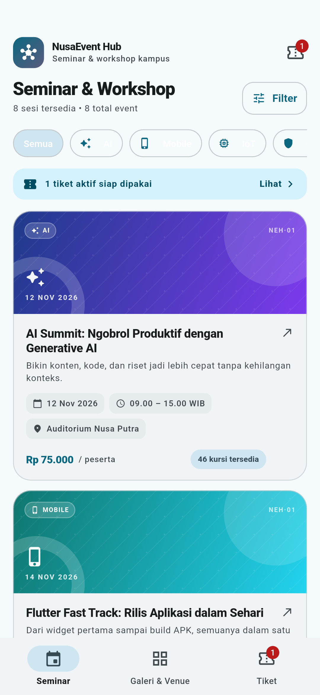
  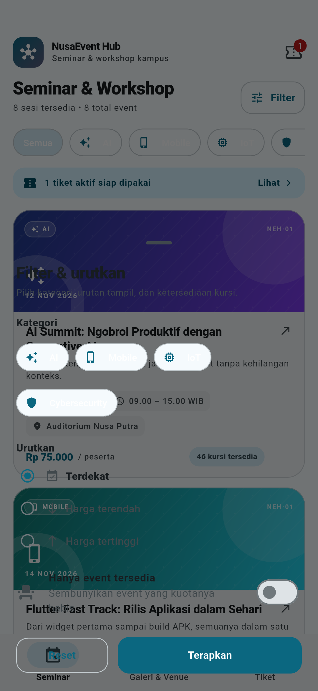
  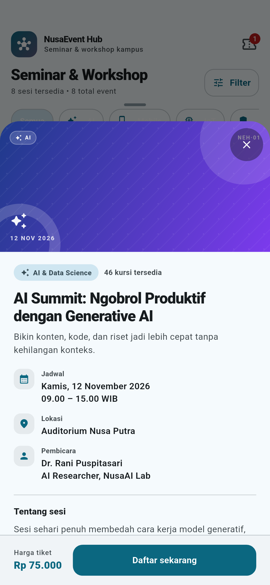
  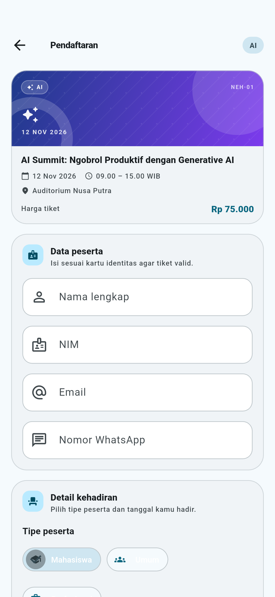
  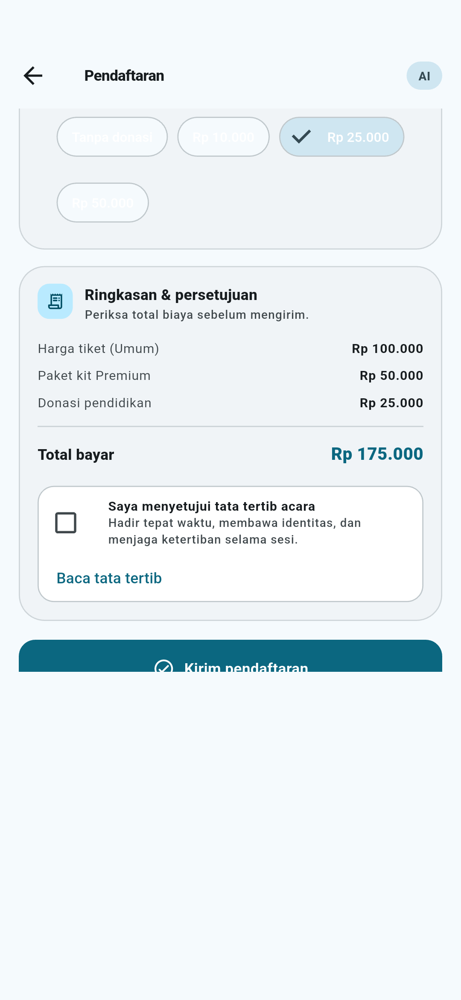
  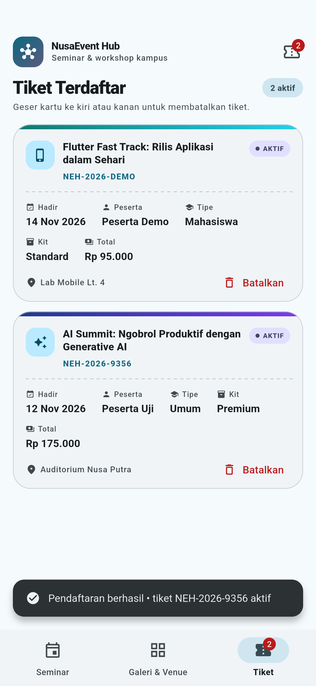
  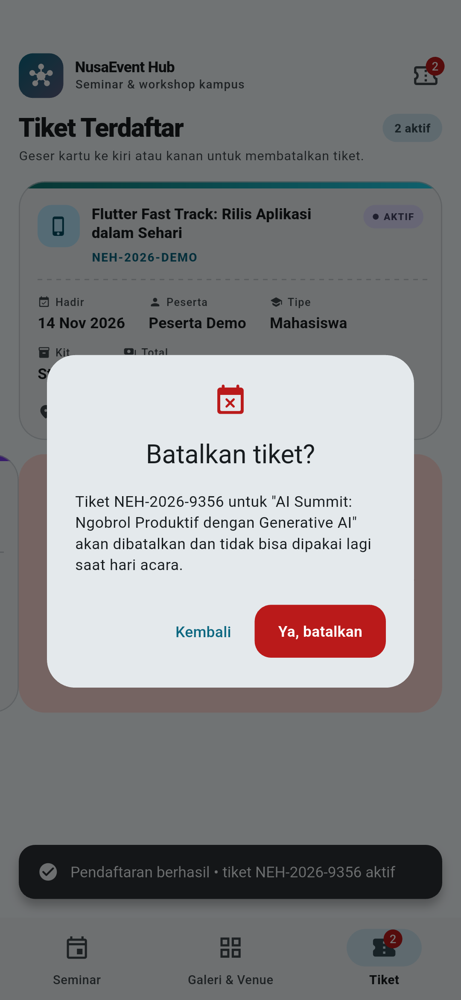
  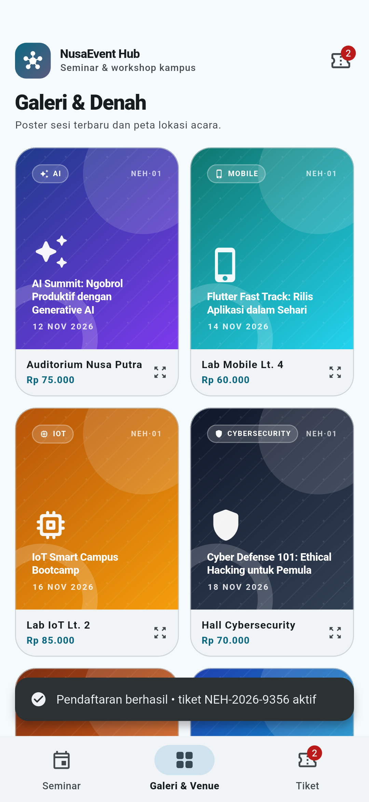
  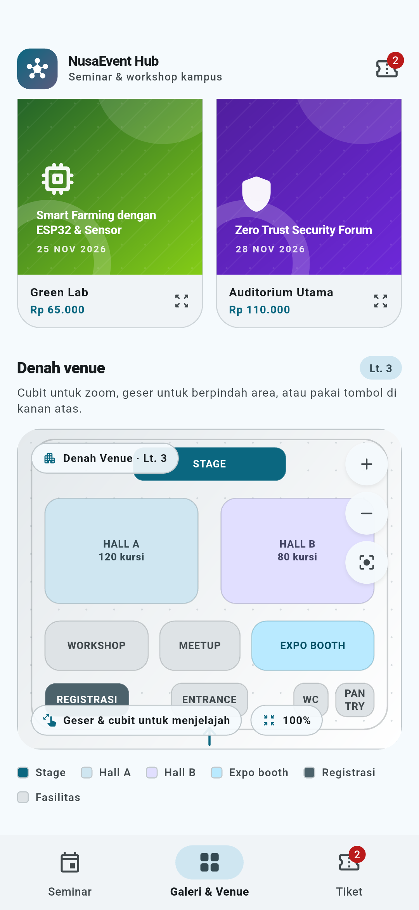
</p>

| # | Fitur | File |
|---|---|---|
| 1 | Daftar seminar | `screenshots/01-seminar-list.png` |
| 2 | Bottom sheet filter | `screenshots/02-filter-bottom-sheet.png` |
| 3 | Filter kategori IoT | `screenshots/03-filter-kategori-iot.png` |
| 4 | Detail event | `screenshots/04-detail-event.png` |
| 5 | Formulir — data peserta | `screenshots/05-form-data-peserta.png` |
| 6 | Date picker | `screenshots/06-date-picker.png` |
| 7 | Formulir — kit & donasi | `screenshots/07-form-kit-donasi.png` |
| 8 | Formulir — ringkasan & tata tertib | `screenshots/08-form-ringkasan-tata-tertib.png` |
| 9 | Loading pendaftaran | `screenshots/09-loading-pendaftaran.png` |
| 10 | Pendaftaran berhasil + tiket | `screenshots/10-pendaftaran-berhasil.png` |
| 11 | Dialog konfirmasi batal | `screenshots/11-konfirmasi-batal.png` |
| 12 | Galeri poster | `screenshots/12-galeri-poster.png` |
| 13 | Denah venue | `screenshots/13-denah-venue.png` |
| 14 | Denah setelah zoom | `screenshots/14-denah-venue-zoom.png` |

## Flutter Inspector

Screenshot DevTools (tab **Flutter Inspector**) saat aplikasi berjalan di HP. Panel kiri
menampilkan widget tree aplikasi, panel kanan menampilkan properti widget, Flex explorer,
dan Render object. Screenshot terakhir diambil dari HP saat **Select Widget Mode** aktif:
widget yang diketuk langsung terpilih di DevTools dan ukurannya tampil sebagai overlay.

<p>
  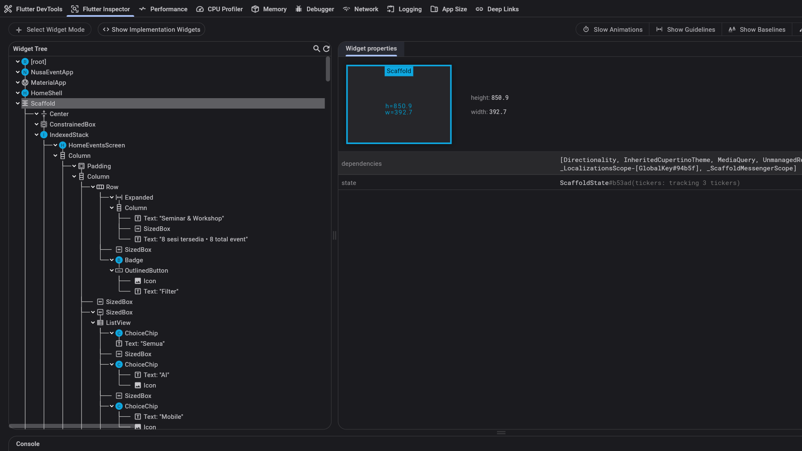
  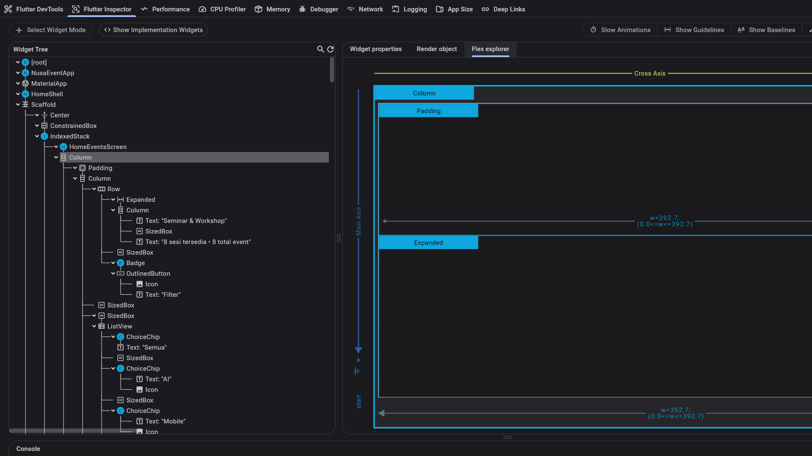
  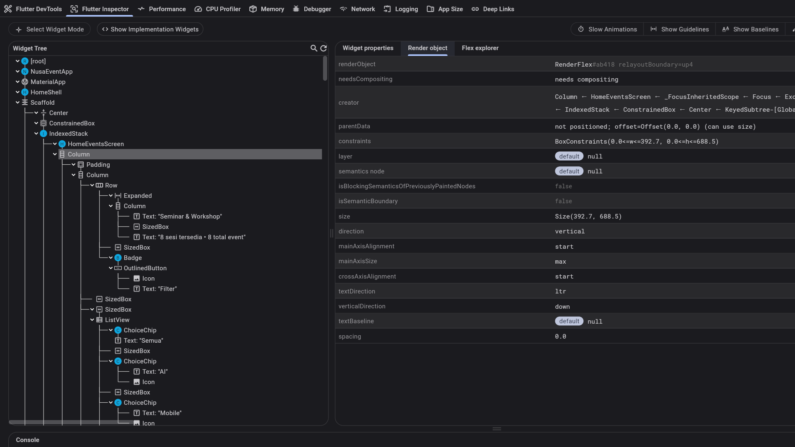
  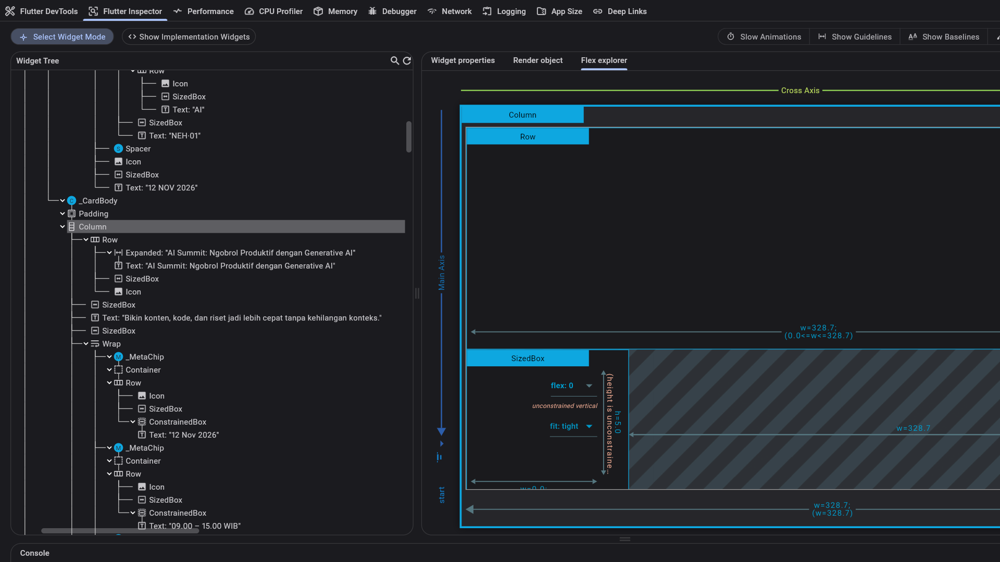
  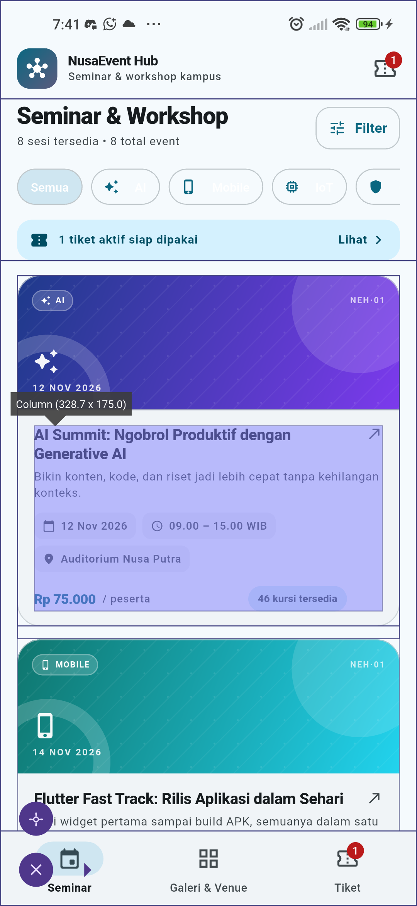
</p>

| # | Fitur | File |
|---|---|---|
| 15 | Widget tree + widget properties | `screenshots/15-inspector-widget-tree-properties.png` |
| 16 | Flex explorer (layout) | `screenshots/16-inspector-flex-explorer.png` |
| 17 | Render object | `screenshots/17-inspector-render-object.png` |
| 18 | Select widget mode — DevTools | `screenshots/18-inspector-select-mode-devtools.png` |
| 19 | Select widget mode — overlay di HP | `screenshots/19-inspector-select-mode-hp.png` |

Cara membuka: jalankan `flutter run`, buka URL DevTools yang tercetak di terminal, lalu
pilih tab **Flutter Inspector**. Aktifkan **Select Widget Mode** dan ketuk widget di HP
untuk memilihnya dari perangkat.

## Verifikasi

```bash
flutter analyze
flutter test
flutter test integration_test/app_test.dart -d <device-id>
```

Integration test menjalankan alur lengkap di perangkat: filter kategori, buka detail,
isi formulir + date picker, kirim pendaftaran, lalu batalkan tiket lewat `Dismissible`.


## Struktur

```
lib/
├── models/
│   ├── event_item.dart
│   └── registration_ticket.dart
├── data/
│   └── sample_events.dart
├── widgets/
│   ├── event_card.dart
│   ├── filter_bottom_sheet.dart
│   └── venue_map_viewer.dart
├── screens/
│   ├── home_events_screen.dart
│   ├── event_registration_screen.dart
│   └── registered_tickets_screen.dart
└── main.dart
```
